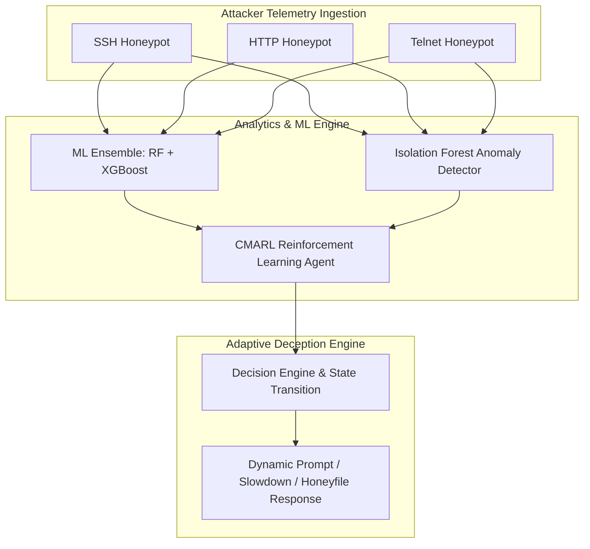

# 🍯 PRAETOR: Research-Grade Stateful Adaptive Honeypot

[](https://www.python.org/)
[](https://fastapi.tiangolo.com/)
[](https://www.docker.com/)
[](LICENSE)

**PRAETOR** is a stateful adaptive honeypot leveraging a machine learning ensemble (Random Forest, XGBoost, Isolation Forest) and a Contextual Multi-Agent Reinforcement Learning (CMARL) Q-learning engine to dynamically optimize deception environments in real time.

---

## 📌 Core Architecture



---

## Research evaluation

The [benchmark report](docs/BENCHMARK_REPORT.md) records internal
digital-twin experiments and a synthetic classifier dataset. The
published figures describe those experiments. Real-world deception
effectiveness, classifier accuracy on live traffic, and public
deployment capacity remain unmeasured.

CI exercises SSH, HTTP and Telnet on loopback, stable host keys,
management access, persistence and disposable container separation.

---

## 🚀 Quickstart

### 1. Installation

```bash
# Clone repository
git clone https://github.com/nayefsiddique-eng/Adaptive-Honeypot.git
cd Adaptive-Honeypot

# Create virtual environment
python -m venv .venv
source .venv/bin/activate  # On Windows: .\.venv\Scripts\Activate.ps1

# Install requirements
pip install -r requirements.txt
```

### 2. Running API Server

```bash
uvicorn backend.main:app --reload --port 8000
```
*Access management docs at `http://127.0.0.1:8000/docs`.*

### 3. Production Isolation Audit Validation

```bash
python scripts/validate_production_isolation.py
```

---

## 📁 Documentation Index

| Document | Purpose |
|---|---|
| [`docs/ARCHITECTURE.md`](docs/ARCHITECTURE.md) | System design, event pipeline, security boundaries |
| [`docs/SECURITY.md`](docs/SECURITY.md) | Security controls, isolation rules |
| [`docs/PRODUCTION_DEPLOYMENT.md`](docs/PRODUCTION_DEPLOYMENT.md) | Docker & VM deployment runbook |
| [`docs/RESEARCH_DOCUMENTATION.md`](docs/RESEARCH_DOCUMENTATION.md) | Full IEEE methodology documentation |

---

## 📜 License

This project is licensed under the MIT License - see the [LICENSE](LICENSE) file for details.

### Local regression tests

Run `python -m pytest tests/` from the repository root. The API management rate
limiter tracks clients within each worker and expires idle client history.
Configure ingress limits for deployments with multiple replicas. Run the
honeypot's protocol listeners in an isolated network segment.

For a stable SSH decoy fingerprint, mount a deployment-specific private host
key and set `SSH_HOST_KEY_PATH` to its container path. The default without a
mounted or locally generated key is a fresh in-memory key per listener startup.

### Reproduce the isolated experiment

Install the requirements in a clean virtual environment and run
`python scripts/verify_loopback.py`. It launches the management API and all
three protocol listeners on loopback with a disposable SQLite database. It
uses harmless commands and a deployment-specific test key. Record the
commit, dependency versions, sample types, counts and observed results before
reporting any detection or performance metric.

The production Compose networks are internal, and published ports default to
loopback. Validate connectivity for the intended Docker host and deployment
before changing that address. For an isolated Docker check, use a disposable
checkout and run `bash scripts/verify_container_isolation.sh`. It creates its
own environment files, volumes and unrelated probe network, and removes them
when finished. The rule-based API works without a trained model. Provide a
separately evaluated model when testing model-backed behavior.

GeoIP uses marked simulated data by default. An operator can configure
`GEOIP_LOOKUP_BASE_URL` with an authorized HTTPS endpoint that accepts an IP
as its last path component and returns the supported GeoIP response fields.
Keep it unset in isolated experiments. Simulated locations are not evidence
of the origin of an interaction.
